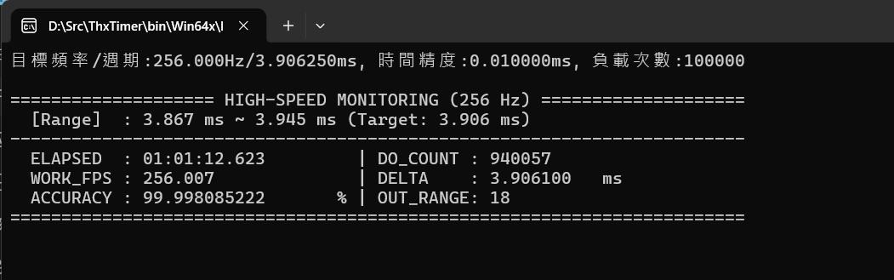
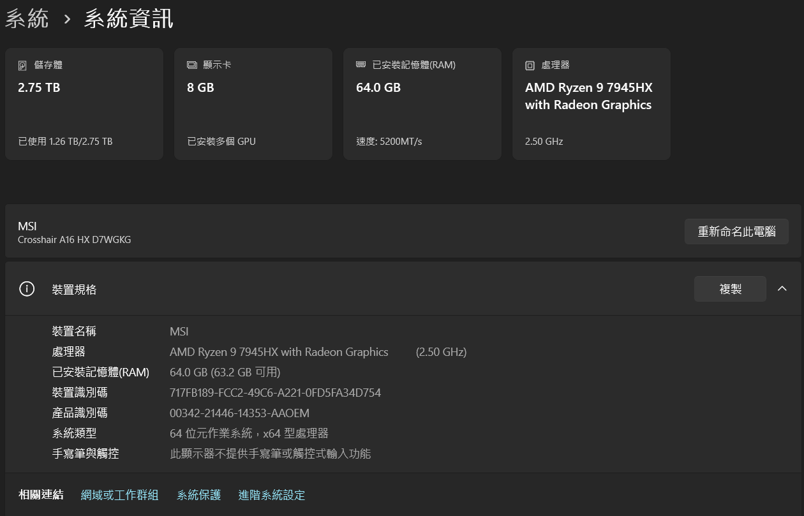

# 🚀 ThxTimerConsole (High-Precision Timer)

**ThxTimerConsole** 是一個專為 Windows 平台設計的高性能計時器框架，基於 **C++Builder (Windows 64-bit Modern)** 開發。本專案核心在於突破 Windows 預設的計時限制，達到工業級的穩定性與毫秒級的精確度。

---

## 📊 效能表現 (Performance Benchmark)

在高性能設備上經過長達一小時的壓力測試，結果如下：

*   **目標頻率**：256 Hz (週期約 3.90625 ms)
*   **平均準確度**：**99.998%**
*   **抖動控制 (Jitter)**：絕大多數 Tick 誤差控制在 **0.05ms** 以內。
*   **穩定性**：具備自動漂移補償機制，長時間運行不累積時間差。

---

## 🛠️ 核心模組介紹 (uFunction Library)

本專案的強大源於 `Reuse\uFunction` 目錄下的獨立工具庫：

| 模組名稱 | 技術特點 | 應用場景 |
| :--- | :--- | :--- |
| **uThreadTimer** | 支援 CPU 親和性 (Affinity) 與 MMCSS 優先權。 | 高頻穩定迴圈、即時數據採集。 |
| **uStopWatch** | 基於 QPC 的高精度計時，支援絕對時間戳校準。 | 效能分析、精確時間差測量。 |
| **uUseNtDll** | 封裝 `NtSetTimerResolution`。 | 將系統解析度從 15.6ms 提升至 **0.5ms**。 |
| **uDosCmd** | 異步管道 (Pipe) 通訊。 | 非阻塞式執行 DOS 指令並即時讀取輸出。 |
| **uUtilize** | 綜合工具集。 | 檔案、INI、加密校驗等日常開發工具。 |

---

## 📊 效能表現與測試環境 (Performance & Environment)

本專案在高性能筆電 **MSI Crosshair A16** 上進行壓力測試，展現了極致的計時穩定性。

### 🚀 測試數據總結
* **測試時長**: 01:01:12 (超過 1 小時)
* **準確度**: **99.998%**
* **總循環次數**: 940,057 次
* **平均誤差 (Delta)**: **3.906100 ms** (目標週期 3.906250 ms)
* **抖動次數 (Out of Range)**: 全程僅 **18 次** 輕微抖動

### 🖼️ 測試截圖與設備證明
| 1 小時穩定性統計 | 測試設備規格 (Ryzen 9 7945HX) |
| :---: | :---: |
|  |  |

> 📁 **完整紀錄**: 你可以查閱原始的 [1 小時測試 Log 日誌](1hour_test_log.txt) 來獲取更詳細的逐秒數據。

## 🛠️ 開發環境 (Development Environment)

本專案完全基於 **Embarcadero RAD Studio 12.2 Athens** 開發，充分利用了其現代化技術棧：

*   **Compiler**: C++Builder **Win64 Modern (bcc64x)** - 基於 Clang 15 的高效能編譯器。
*   **Framework**: VCL / Console Application 混合架構。
*   **SDK**: Windows 11 SDK (10.0.22621.0)。
*   **Key APIs**: 整合了 `ntdll.dll` (系統底層計時控制) 與 `MMCSS` (多媒體類別排程服務)。

> **為什麼選擇 XE 12.2？**
> 透過 12.2 版本引入的編譯器優化，`uThreadTimer` 能以極低的指令開銷（Overhead）執行，這對於維持 256Hz 高頻且不跳動的循環至關重要。

## 🚀 快速開始

1. **Clone 專案**：
   ```bash
   git clone [https://github.com/你的帳號/ThxTimerConsole.git](https://github.com/你的帳號/ThxTimerConsole.git)
開啟專案：
使用 C++Builder 開啟 proj\console\ThxTimerConsole.cbproj。

設定路徑：
確保專案設定中的 Include Path 包含 ./Reuse/uFunction。

編譯平台：
請務必選擇 Windows 64-bit (Modern) 以獲得最佳效能。

📝 授權 (License)
本專案採用 MIT License。歡迎自由使用、修改並提交 Pull Request。
